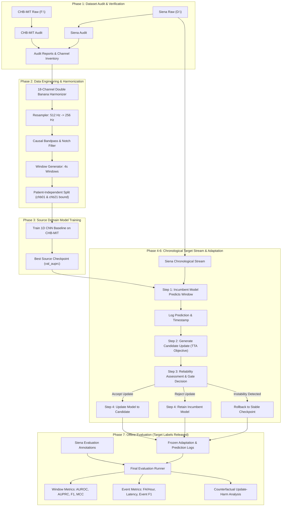

# End-to-End System Architecture

## Overview

The research system implements a rigorous cross-dataset EEG seizure detection and chronological test-time adaptation pipeline.



---

## Directory Organization

```
D:\EEG_Research\
├── config/              # Centralized YAML configurations
├── data/
│   ├── manifests/       # Patient-level training/val split CSV manifests
│   ├── metadata/        # Audited inventories (recordings, seizures, channels)
│   ├── processed/       # Incremental cache files (HDF5/NumPy memmap)
│   └── evaluation_annotations/ # Isolated Siena annotations (unlocked in Phase 7 only)
├── src/
│   ├── audit/           # Audit modules (chbmit, siena, channel, reports)
│   ├── data/            # EDF loaders, causal preprocessors, window generators
│   ├── models/          # 1D CNN and lightweight TCN architectures
│   ├── training/        # Source trainer, loss functions, checkpoint manager
│   ├── adaptation/      # TTA baselines (TENT, EATA, SAR) & proposed reliability gate
│   ├── evaluation/      # Window, event, calibration, and counterfactual evaluators
│   └── utils/           # Hardware, reproducibility, memory managers
├── scripts/             # Executable CLI scripts (01 to 10)
├── experiments/         # Logs, metrics, predictions, checkpoints, and reports
└── docs/                # Architecture, methodology, decisions, logs
```
